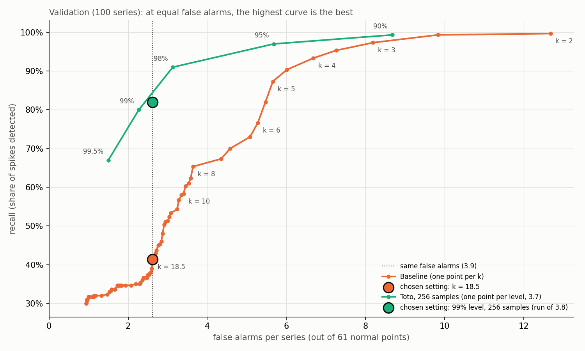

# Incident detection on metrics with Toto

Can a forecasting model catch incidents on infrastructure metrics better than a simple statistical rule, and can it be served at scale?

This project tests [Toto](https://github.com/DataDog/toto), Datadog's open-source time series model, on 200 real metrics from the [BOOM](https://huggingface.co/datasets/Datadog/BOOM) dataset. Toto forecasts an interval for the next 64 points, and a point outside this interval is flagged as an anomaly. Toto is compared to a simple baseline (median ± k × MAD), then served behind an asynchronous API with a queue and batching, and load tested.

## Key results

| | Result |
|---|---|
| **Detection at equal false alarms** | Toto finds **82%** of the incidents, the baseline **41%** |
| **Test set** (100 series, 300 incidents) | Toto finds 85% (3.0 false alarms / series), the tuned baseline 45% (1.7) |
| **Cost** | Toto takes about 2.3 s per series on CPU, around 70,000 times the baseline |
| **API under load** (32 clients, 3 min) | About 3 series/s on a laptop, 0 failures, +14% throughput with batching |



Each point is a setting. At the same number of false alarms, Toto (green) finds more incidents than the baseline (orange) over the whole range.

## How it works

```
client ── POST /v1/detection-jobs ──▶ FastAPI ──▶ queue (100 jobs max) ──▶ worker ──▶ Toto or baseline
       ◀── 202 {"job_id"} ─────────────┘                                     │ up to 16 jobs per model call
client ── GET /v1/detection-jobs/{id} ──▶ FastAPI ◀── status and results ────┘
```

- **Asynchronous API**: a request gets `202` and a `job_id` right away, then the client polls for the result.
- **Bounded queue**: when it is full, the API answers `429` instead of slowing down for everyone.
- **Batching**: the worker groups jobs into one model call, in a separate thread, so the API stays responsive.

The API contract is in [`docs/api_spec.md`](docs/api_spec.md).

## Takeaways

- **Toto detects twice as many incidents** as the baseline at the same false alarm rate, because its interval follows cycles and level changes, while the baseline interval is flat.
- **The model is the bottleneck, not the API.** At about 3 series/s per laptop (fast setting, 32 samples), checking 1 million series every 5 minutes would need about 1,100 machines.
- **Path to Datadog scale**: GPU inference with large batches, Kafka instead of the in-memory queue, stateless workers, and a cascade where the baseline filters most series before Toto. This part is not measured here.

## Limitations

- Incidents are simulated: spikes of 5 standard deviations injected into real series. No level shifts or slow drifts.
- 100 test series: differences of a few points are not significant.
- The load test uses 32 samples instead of 256: faster, but lower quality (validation F1 from 0.61 to 0.48).
- Demo API: jobs kept in memory, a single worker, no authentication.

## Run it

```
python -m venv .venv && source .venv/bin/activate
pip install -r requirements.txt
python src/data.py                  # downloads 200 BOOM series

uvicorn api:app --app-dir src       # terminal 1: API, docs at http://localhost:8000/docs
streamlit run src/demo_app.py       # terminal 2: demo page at http://localhost:8501
```

The demo page also works without the API, from precomputed results.

**More details** (evaluation method, tuning, example series, load test, scaling): [`docs/details.md`](docs/details.md).
