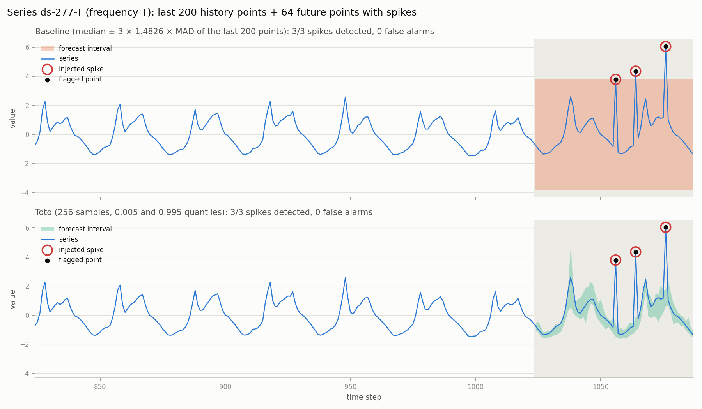
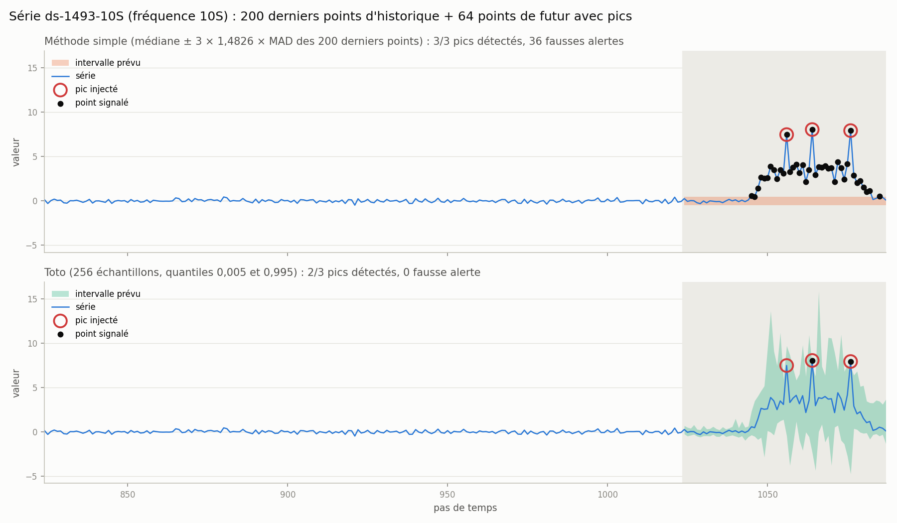
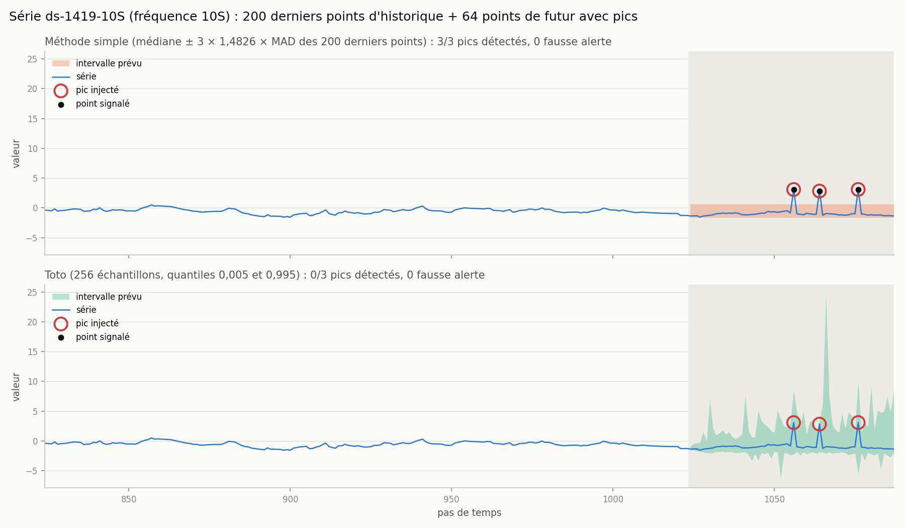

# Détection d'incidents sur métriques avec Toto

Un incident (déploiement buggé, requête lente en base, afflux de trafic) se voit souvent comme un **pic sur une métrique** : taux d'erreur, latence, nombre de requêtes.
Il faut le repérer **en quelques minutes**, avant les clients, **sans fausses alertes** : trop d'alertes inutiles et l'astreinte finit par les ignorer.
Ce projet teste [Toto](https://github.com/DataDog/toto), le modèle de prévision open source de Datadog, pour ce cas d'usage. Toto prévoit un intervalle pour les 64 prochains points, et un point qui en sort est une anomalie. Toto est comparé à une méthode simple, puis servi derrière une API asynchrone avec batching, testée en charge.

## Architecture

```
client (src/client.py, Locust)
  │   POST /v1/detection-jobs        ──▶ 202 {"job_id"}   (400 si invalide, 429 si file pleine)
  │   GET  /v1/detection-jobs/{id}   ──▶ 200 {"status", "results"}   (polling jusqu'à done)
  ▼
API FastAPI (src/api.py) ─────── lit ──────▶ stockage des jobs (dictionnaire en mémoire)
  │ put_nowait(job_id)                                  ▲
  ▼                                                     │ écrit le statut et les résultats
file asyncio.Queue (100 jobs au plus)                   │
  │ jusqu'à BATCH_SIZE jobs, ou ceux arrivés en MAX_WAIT_MS
  ▼                                                     │
worker (src/worker.py) ─────────────────────────────────┘
  │ un appel au modèle par batch, dans asyncio.to_thread (l'API reste réactive)
  ▼
Toto ou méthode simple (src/detectors.py), chargés une seule fois au démarrage
```

Le contrat de l'API (endpoints, JSON, codes de statut, format d'erreur) est dans [`docs/api_spec.md`](docs/api_spec.md).

## Lancer le projet

Installation (Python 3.12) :

```
python -m venv .venv
source .venv/bin/activate
pip install -r requirements.txt
python src/data.py           # télécharge 200 séries BOOM dans data/series.npz
python src/check_toto.py     # vérifie que Toto se charge et prévoit
```

Évaluation hors API :

```
python src/evaluate.py                  # comparaison brute, results/eval.csv (~10 min sur CPU)
python src/tuning.py                    # réglages sur la validation, résultats sur le test (~15 min)
python src/plot_detectors.py --index 42 # figure d'une série, results/series_42_detectors.png
```

API, dans deux terminaux :

```
uvicorn api:app --app-dir src
python src/client.py --index 42 --method toto
```

La documentation interactive est sur `http://localhost:8000/docs`. Les variables d'environnement `BATCH_SIZE` (16), `MAX_WAIT_MS` (50) et `TOTO_SAMPLES` (256) règlent le worker. Pour le test de charge, voir [plus bas](#test-de-charge).

| Fichier | Rôle |
|---|---|
| `src/data.py` | chargement de BOOM, découpage historique / futur, injection de pics |
| `src/detectors.py` | méthode simple et Toto, avec la même interface `predict_interval(_batch)` |
| `src/evaluate.py`, `src/tuning.py` | métriques, réglages sur la validation, résultats sur le test |
| `src/api.py`, `src/schemas.py`, `src/worker.py` | API, validation des requêtes, worker avec batching |
| `src/client.py`, `loadtest/locustfile.py` | client de démonstration, test de charge |

## Méthode d'évaluation

**Données.** 200 vraies séries du dataset [BOOM](https://huggingface.co/datasets/Datadog/BOOM) (métriques d'observabilité de Datadog), avec une seule variable par série. Chaque série est découpée en un historique de 1024 points et un futur de 64 points. Les incidents sont simulés : 3 pics sont ajoutés dans le futur, de hauteur 5 × l'écart-type de l'historique, à des positions tirées au hasard (seed `i` pour la série `i`).

**Détecteurs.**
- **Méthode simple** : médiane ± k × 1,4826 × MAD des 200 derniers points, soit un intervalle constant sur les 64 points.
- **Toto** (`Datadog/Toto-Open-Base-1.0`) : quantiles d'un niveau donné sur `num_samples` trajectoires prévues.

Un point du futur hors de l'intervalle est signalé.

**Métriques.** Un point signalé est un vrai positif (TP) s'il s'agit d'un pic injecté, et une fausse alerte (FP) sinon.

| Métrique | Définition |
|---|---|
| Rappel | TP / pics injectés |
| Précision | TP / (TP + FP), sur les totaux de toutes les séries |
| F1 | 2 × précision × rappel / (précision + rappel) |
| Fausses alertes / série | FP / nombre de séries |
| ms / série | temps de calcul moyen, après un appel d'échauffement |

**Validation et test.** Les 200 séries sont coupées en deux moitiés de 100, tirées au hasard avec une seed fixe. Les réglages sont choisis **uniquement sur la validation**, et les résultats sont annoncés **uniquement sur le test** :
- **niveau de l'intervalle de Toto** : 99 %, qui maximise le F1 de validation (0,626, contre 0,616 à 98 % et 0,618 à 99,5 %) ;
- **nombre de tirages** : 256, le plus petit dont le F1 est à moins de 0,01 du meilleur (128 tirages est à 0,02) ;
- **`k` de la méthode simple** : 18,5, choisi pour avoir autant de fausses alertes que Toto sur la validation (2,62 par série).

## Résultats

### Qualité de détection, sur le test (100 séries, 300 pics)

| Détecteur | Rappel | Précision | F1 | Fausses alertes / série | ms / série |
|---|---|---|---|---|---|
| Méthode simple, k = 3 (réglage par défaut) | 98,0 % | 20,9 % | 0,344 | 11,2 | 0,03 |
| Méthode simple, k = 18,5 (fausses alertes égales sur la validation) | 44,7 % | 44,5 % | 0,446 | 1,7 | 0,03 |
| Toto réglé (niveau 99 %, 256 tirages) | **85,3 %** | **46,5 %** | **0,602** | 3,0 | 2269 |

Source : [`results/eval_test.csv`](results/eval_test.csv). Le `k` est réglé sur la validation, si bien que sur le test la méthode simple fait un peu moins de fausses alertes que Toto (1,7 contre 3,0 par série).

### Rappel en fonction des fausses alertes (validation)


Chaque point est un réglage : une valeur de `k` pour la méthode simple, un niveau d'intervalle pour Toto. À nombre de fausses alertes égal, la courbe la plus haute est la meilleure. La courbe de Toto est au-dessus sur toute la plage commune. Au réglage retenu (2,62 fausses alertes par série), **Toto détecte 82 % des pics, contre 41 % pour la méthode simple**.

### Exemples de séries

Ces figures utilisent les réglages par défaut (k = 3, 256 tirages), pas le `k` réglé.

**Série cyclique** (`ds-277-T`). L'intervalle de Toto suit le cycle. Celui de la méthode simple doit couvrir tout le cycle, et ne détecte ici les pics que parce qu'ils dépassent le haut du cycle.



**Hausse réelle dans le futur** (`ds-1493-10S`). La méthode simple signale toute la hausse (36 fausses alertes). L'intervalle de Toto s'élargit au moment de la hausse, ce qui donne 0 fausse alerte, mais il rate un des trois pics.



**Cas où Toto échoue** (`ds-1419-10S`). Toto prévoit un intervalle très large et rate les trois pics, que la méthode simple détecte.



D'autres séries sont dans [`results/`](results/).

### Test de charge

**Le choix du nombre de tirages.** Le worker regroupe jusqu'à `BATCH_SIZE` jobs et les envoie à Toto en un seul appel. Toto duplique chaque série `num_samples` fois dans son batch interne. Pour qu'un batch de 16 jobs passe vraiment en un seul appel, il faut donc `16 × num_samples ≤ max_samples_per_call`.

Avec 256 tirages, il faudrait 4096 lignes par appel : sur CPU (16 Go), la machine swappe et l'appel devient environ 10 fois plus lent. Avec `max_samples_per_call = 512`, un batch de 16 séries est découpé en 8 appels de 2 séries, et le batching ne sert plus à rien. Mesure sur 16 séries, en régime établi :

| Tirages | Une série par appel | 16 séries d'un coup | Appels pour 16 séries |
|---|---|---|---|
| 32 | 440 ms / série | 318 ms / série | 1 |
| 256 | 2865 ms / série | 2956 ms / série | 8 |

**Le test de charge utilise donc `TOTO_SAMPLES=32`.** On a alors 16 × 32 = 512 tirages, soit un seul appel par batch. Le prix à payer est la qualité : sur la validation, le F1 passe de 0,61 à 0,48 (`results/tuning_toto_samples.csv`). Par défaut, l'API garde 256 tirages. Sur GPU, on garderait 256 tirages et on monterait `max_samples_per_call` à 4096.

**Lancer le test.** Terminal 1, le serveur (refaire avec `BATCH_SIZE=16`) :

```
BATCH_SIZE=1 TOTO_SAMPLES=32 uvicorn api:app --app-dir src --no-access-log
```

Terminal 2, Locust avec 32 utilisateurs pendant 3 minutes :

```
locust -f loadtest/locustfile.py --host http://localhost:8000 --headless -u 32 -r 32 -t 3m --csv loadtest/out/batch1
```

Une fois les deux tests passés, `python loadtest/summarize.py` écrit [`results/loadtest.csv`](results/loadtest.csv).

**Résultats.** Toto (32 tirages, niveau 99 %) sur CPU (MacBook Air, 16 Go). Chaque job contient une série, et chaque utilisateur enchaîne les jobs sans pause.

| Batch | Séries / s | Latence p50 (bout en bout) | Latence p95 (bout en bout) | Jobs terminés |
|---|---|---|---|---|
| 1 | 2,67 | 12 s | 14 s | 478 |
| 16 | 3,04 | 10 s | 12 s | 544 |

- **Débit : +14 %.** Avec `BATCH_SIZE=16`, les 35 batchs étaient tous pleins. Le gain reste modeste, car sur CPU le modèle est déjà presque saturé par les tirages de chaque série. Sur GPU, un batch plus gros occuperait des cœurs inutilisés, et le gain serait bien plus grand.
- **Latence : −2 s.** Ici, la latence est surtout de l'attente dans la file. Avec 32 utilisateurs, la loi de Little donne latence ≈ utilisateurs / débit, soit 32 / 2,67 ≈ 12 s et 32 / 3,04 ≈ 10,5 s, ce qui correspond aux mesures. Le batching réduit la latence parce qu'il augmente le débit. À faible charge, ce serait l'inverse : un job attendrait jusqu'à `MAX_WAIT_MS`, puis la fin de tout son batch.
- **Aucun échec**, aucun `429` : la file (100 jobs) n'a jamais été pleine avec 32 utilisateurs.

## Conclusion

- **À fausses alertes égales, Toto est nettement meilleur.** Sur la validation, il détecte 82 % des pics contre 41 % pour la méthode simple. Sur le test, son F1 est de 0,60, contre 0,45 pour la méthode simple réglée et 0,34 pour la méthode simple par défaut. La différence vient de l'intervalle : celui de Toto suit les cycles et le niveau de la série, alors que celui de la méthode simple est plat.
- **Mais Toto coûte beaucoup plus cher.** Il faut environ 2,3 s par série sur CPU avec 256 tirages, contre 0,03 ms pour la méthode simple, soit à peu près 70 000 fois plus. Moins de tirages réduit le coût mais aussi la qualité : avec 32 tirages, le calcul est 7 fois plus rapide, mais le F1 de validation passe de 0,61 à 0,48. Le batching ne rattrape que 14 % sur CPU.
- **Une cascade combinerait les deux.** La méthode simple, avec un `k` bas (k = 3 détecte 98 % des pics), filtrerait toutes les séries à chaque instant. Toto ne traiterait que les séries suspectes, pour éliminer leurs fausses alertes. Le coût de Toto deviendrait alors proportionnel à la part de séries suspectes, faible en production où la plupart des séries sont normales la plupart du temps. Dans ce benchmark, au contraire, chaque série contient des pics : la cascade n'y ferait rien gagner, il faudrait la mesurer sur des données plus réalistes. Son rappel serait aussi limité par celui du filtre.

## Limites

- **Incidents simulés.** Les pics sont injectés sur de vraies séries. Ils ne couvrent ni les changements de niveau, ni les dérives lentes, ni les chutes à zéro. Une hauteur de 5 écarts-types reste un cas plutôt facile.
- **Anomalies réelles non étiquetées.** Une vraie anomalie présente dans le futur compte comme fausse alerte, comme la hausse de `ds-1493-10S`.
- **Les deux faiblesses de la méthode simple, gardées volontairement :**
  - **Intervalle plat** : il ne suit pas les cycles, peut rater un pic posé dans un creux et signale les sauts réguliers comme anomalies.
  - **MAD nulle** : sur une série presque constante (par exemple `ds-1525-5T`), la MAD vaut 0 et l'intervalle aurait une largeur nulle. On la remplace alors par l'écart-type de la fenêtre.
- **Toto est aléatoire.** Ses tirages changent d'un lancement à l'autre, et donc parfois les points signalés. Il peut aussi prévoir un intervalle très large et ne rien détecter (`ds-1419-10S`).
- **100 séries de test.** Des écarts de quelques points de rappel ou de précision ne sont pas significatifs.
- **API de démonstration.** Jobs en mémoire, un seul worker, pas d'authentification (voir les limites dans [`docs/api_spec.md`](docs/api_spec.md)). Le test de charge utilise 32 tirages et non 256.

## À l'échelle de Datadog

**File et stockage.** La file en mémoire serait remplacée par **Kafka**, qui conserve les points même si un worker tombe et permet de rejouer un flux. Les séries y seraient **partitionnées par identifiant**, si bien que tous les points d'une série arrivent dans l'ordre au même worker, qui peut garder son historique à portée de main. Le dictionnaire des jobs deviendrait un **stockage persistant** (Redis avec une durée de vie, ou une base de données), partagé par toutes les instances de l'API.

**Inférence et workers.** L'inférence se ferait sur **GPU avec de gros batchs**. C'est là que le batching paie : 256 tirages × des dizaines de séries par appel, là où le CPU sature déjà. Les **workers seraient sans état et répliqués horizontalement** (un groupe de consommateurs Kafka), et on en ajouterait automatiquement quand le retard de la file augmente.

**Coût.** La cascade réserverait le GPU aux séries suspectées par la méthode simple.
